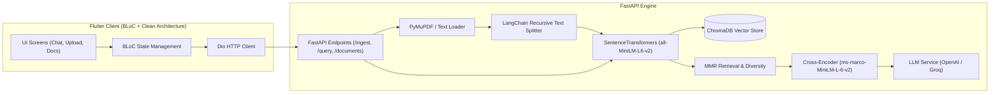

# 🧠 Full-Stack RAG Knowledge Assistant

A production-grade, full-stack **Retrieval-Augmented Generation (RAG)** application consisting of a **FastAPI** backend and a **Flutter** multi-platform client (macOS, iOS, Web, Android).

Upload documents (PDF, TXT, Markdown), index them into a local vector store, and ask questions with grounded citations, semantic search, and reranking.

---

## 🏗️ Architecture & Tech Stack



### Backend
- **Framework:** FastAPI with async lifespan management & CORS.
- **Parsing:** PyMuPDF (`fitz`) for PDF page extraction; UTF-8 decoder for TXT/MD.
- **Chunking:** `langchain-text-splitters` Recursive Character Splitter (default: 500 chars, 50 overlap).
- **Embeddings:** `sentence-transformers/all-MiniLM-L6-v2` (runs 100% locally, zero cost, ~90MB).
- **Vector Store:** ChromaDB persistent storage with cosine similarity indexing.
- **Search & Retrieval:** Bi-encoder similarity search + Maximal Marginal Relevance (MMR) for diversity.
- **Reranker:** Cross-Encoder (`cross-encoder/ms-marco-MiniLM-L-6-v2`, ~80MB) for fine-grained ranking.
- **Inference:** OpenAI-compatible client supporting official OpenAI or GroqCloud LPUs.

### Frontend
- **Framework:** Flutter (Material 3 with automatic Light / Dark mode).
- **State Management:** `flutter_bloc` with events and states.
- **Architecture:** Clean Architecture (`data`, `domain`, `presentation`) + `get_it` dependency injection.
- **Networking:** Dio with logging interceptors, handling streaming bytes for file uploads across Web, Desktop, and Mobile.
- **Platforms Supported:** macOS Desktop, Web (Safari, Chrome), iOS, Android.

---

## 📁 Project Structure

```
rag-assistant-fullstack/
├── .vscode/
│   └── launch.json                # Pre-configured launch targets for IDE
├── backend/
│   ├── app/
│   │   ├── api/                   # Route handlers (health, ingest, chat)
│   │   ├── core/                  # App config & custom logger
│   │   ├── schemas/               # Pydantic request/response models
│   │   ├── services/              # Ingestion, chunking, embedder, reranker, LLM
│   │   └── main.py                # FastAPI entry point & CORS
│   ├── requirements.txt           # Python dependencies
│   └── .env                       # Environment variables (API keys, models)
├── flutter_app/
│   ├── lib/
│   │   ├── core/                  # Constants, network client, failures
│   │   ├── data/                  # Data sources, repository implementations, models
│   │   ├── domain/                # Entities, repository interfaces, use cases
│   │   ├── presentation/          # BLoCs and UI pages (Chat, Upload, Documents)
│   │   └── main.dart              # Flutter entry point & DI setup
│   ├── macos/                     # macOS runner with network & file entitlements
│   ├── ios/                       # iOS runner with deployment target & ATS config
│   ├── web/                       # Web runner assets and index.html
│   └── pubspec.yaml               # Flutter package configuration
└── README.md
```

---

## 🚀 Getting Started

### Prerequisites
- **Python:** 3.9+ installed
- **Flutter:** 3.0+ SDK (`flutter doctor` should be clean)
- **Xcode & CocoaPods:** (Required for macOS and iOS targets)

---

### 1. Backend Setup

#### Step 1: Create a virtual environment & install dependencies
```bash
cd backend
python3 -m venv venv
source venv/bin/activate
pip install --upgrade pip
pip install -r requirements.txt
pip install chromadb
```

#### Step 2: Configure Environment Variables
Create or edit `backend/.env`:

**Option A: Using GroqCloud (Free / Ultra-fast)**
```env
OPENAI_API_KEY=gsk_yourGroqKeyHere
OPENAI_BASE_URL=https://api.groq.com/openai/v1
LLM_MODEL=qwen/qwen3.8-27b
```

**Option B: Using Official OpenAI**
```env
OPENAI_API_KEY=sk-proj-yourOpenAIApiKeyHere
LLM_MODEL=gpt-4o-mini
```

#### Step 3: Run the Backend
```bash
uvicorn app.main:app --reload --host 0.0.0.0 --port 8000
```
Open **`http://localhost:8000/docs`** to access the interactive Swagger UI.

---

### 2. Frontend Setup (Flutter)

#### Step 1: Install packages
```bash
cd flutter_app
flutter pub get
```

#### Step 2: Configure Network Target
If running on an Android Emulator, open [api_constants.dart](file:///Users/shivamthapa/RAG-projects/rag-assistant-fullstack/flutter_app/lib/core/constants/api_constants.dart) and set:
```dart
static const String baseUrl = 'http://10.0.2.2:8000'; // For Android Emulator
```
For **macOS Desktop**, **iOS Simulator**, and **Web**, keep the default:
```dart
static const String baseUrl = 'http://localhost:8000';
```

#### Step 3: Run on Your Desired Platform

##### A. Native macOS Desktop
```bash
flutter run -d macos
```

##### B. Web Browser (Safari / Chrome)
Enable web once if disabled:
```bash
flutter config --enable-web
```
Start the web server:
```bash
flutter run -d web-server --web-port 8080
```
Then open `http://localhost:8080` in Safari or Chrome.

##### C. iOS Simulator
```bash
cd ios
pod install
cd ..
flutter run -d "iPhone 17 Pro" # Or any simulator from 'flutter devices'
```

---

## 📡 API Reference

| Method | Endpoint | Description | Sample Request |
| :--- | :--- | :--- | :--- |
| `GET` | `/health` | Health and configuration status | - |
| `POST` | `/ingest` | Upload & chunk document (`.pdf`, `.txt`, `.md`) | Multipart Form: `file` |
| `POST` | `/query` | Query knowledge base with RAG retrieval | `{"question": "Summarize key points", "top_k": 5}` |
| `GET` | `/documents` | List indexed documents and chunk statistics | - |
| `DELETE` | `/documents/{filename}` | Delete all indexed chunks of a document | URL param: `filename` |

---

## 🧪 Testing the Application

### 1. Manual End-to-End Workflow Test
1. Launch both Backend (`uvicorn`) and Frontend (`flutter run`).
2. Go to the **Upload** page in the Flutter app. Pick a sample `.pdf` or `.txt` document and submit.
3. Confirm that the **Documents** tab lists the uploaded document with its total chunk count.
4. Navigate to the **Chat** tab and ask a question relevant to the file.
5. Verify that:
   - The LLM streams or displays the grounded answer.
   - **Source cards** appear below the message showing filename, chunk index, and relevance score.

### 2. API Testing via cURL
```bash
# 1. Health check
curl http://localhost:8000/health

# 2. Ingest a document
curl -X POST "http://localhost:8000/ingest" \
  -H "accept: application/json" \
  -H "Content-Type: multipart/form-data" \
  -F "file=@/path/to/sample.pdf"

# 3. Query the index
curl -X POST "http://localhost:8000/query" \
  -H "Content-Type: application/json" \
  -d '{"question": "What are the main takeaways?", "top_k": 3}'
```

---

## 🛠️ Troubleshooting

### 1. `MACOSX_DEPLOYMENT_TARGET` / `IPHONEOS_DEPLOYMENT_TARGET` Error in Xcode
- **Issue:** Xcode 16+ enforces minimum targets of `12.0` for macOS and `15.0` for iOS simulator.
- **Fix:** Both `Runner.xcodeproj` and `Podfile` are configured with target overrides:
  - macOS: `12.0`
  - iOS: `15.0`

### 2. Network / File Access Blocked on macOS Desktop
- **Issue:** macOS sandboxing blocks outbound HTTP and file access by default.
- **Fix:** Ensure `DebugProfile.entitlements` and `Release.entitlements` include:
  ```xml
  <key>com.apple.security.network.client</key>
  <true/>
  <key>com.apple.security.files.user-selected.read-only</key>
  <true/>
  ```

### 3. Groq `model_not_found` Error
- **Issue:** Some Meta Llama models (`llama-3.1-8b-instant`, `llama-3.3-70b-versatile`) may be restricted on certain GroqCloud accounts.
- **Fix:** Use the verified active model `qwen/qwen3.8-27b` in `backend/.env`.

---

## 📄 License

This project is licensed under the MIT License.

